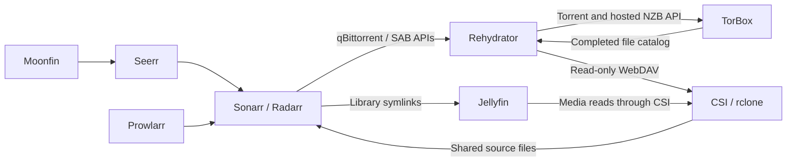

# v0.7.0: Rehydrator as the TorBox gateway

Status: the opt-in backend implementation is present. Automated tests use
PostgreSQL and mocked providers; live TorBox, CSI, Arr and Jellyfin acceptance
remains deployment work. UI work is deferred.

Use [the operational setup](../torbox-gateway-setup.md) for accepted configuration,
client settings, CSI examples and diagnostics. The implementation does not reset
a database, change cluster resources or migrate old Decypharr library paths.

## v0.7.1 runtime split

The gateway/controller roles are now implemented. A `gateway` process publishes
catalogs and serves client/WebDAV APIs without CSI or tenant filesystem access.
A `controller` process leases staging/verification work against the same tenant
database and retains Arr/Jellyfin integrations. Each tenant can own its controller
while its paired gateway runs in another namespace. `combined` preserves the
original single-process mode. Apply migration 033 before starting the new roles.
See the setup guide for per-role configuration and Kubernetes examples.

## Workflow and ownership



Arr retains discovery, release selection, monitoring, quality upgrades and import.
Rehydrator retains original sources, owns cloud submissions, stages symlinks,
serves the catalog and recovers missing placements. TorBox owns transfers and NZB
repair/extraction. CSI-rclone owns FUSE; Jellyfin owns indexing and playback.
Decypharr remains available in legacy mode and is unused by direct-mode acquisition,
source capture, readiness and recovery.

## Persistence and identity

Migration `032_direct_gateway.sql`, after migration 031, adds:

| Storage | Contents |
|---|---|
| `gateway_sources` | Protocol, original magnet or payload, filename, fingerprint and torrent hash |
| `gateway_jobs` | Stable job UUID, source reference, category, provider placement, file catalog, state, reservation and retry counters |
| `gateway_sessions` | Hashed session token, tenant and expiry |
| `media_cache_cloud_usenet_gate` | Shared per-tenant submission gap, reused by both protocols |
| Existing media/source tables | Movie/episode import bindings, lifecycle and Jellyfin refresh audit |

Jobs consolidate release, placement and attempt state instead of introducing
separate tables for each. Original sources are independent of imported media;
media cleanup cannot cascade into the retained gateway source or job. Original
payloads remain in jobs for compatibility with the original cloud worker.
Existing cloud jobs are copied with their client IDs unchanged, retaining the
legacy table. The schema initialization and migration are repeatable.

For v1 torrents, the client-facing qBittorrent hash is the validated BTIH. It is
separate from the stable `torrent-<uuid>` job and TorBox's numeric placement ID.
NZBs use `cloud-nzb-<uuid>` jobs and never acquire torrent hashes. A torrent file
is retained as bytes; its derivable identity does not authorize manufacturing a
magnet. V2/hybrid metainfo is rejected by this gateway.

The original source is validated and committed before client acknowledgement.
Duplicate torrent adds reuse the tenant/hash job without resetting in-flight
leases, unknown outcomes or attempt budgets. A torrent hash has one configured
category. Repeated NZB adds deduplicate by tenant, category and source digest.

## Shared engine

`internal/gateway` contains the worker, qBittorrent/SAB adapters, staging and DAV.
`internal/cloudusenet` provides a compatibility wrapper for legacy cloud-only
call sites. A deployment enables either the shared direct gateway or the separate
cloud-only backend, never both workers.

The worker durably reserves a job before provider I/O. States are:

```text
Queued -> Submitting -> Downloading -> Mounting -> Completed
                   \-> SubmissionUnknown
Completed -> Missing -> Queued (after confirmed loss, within budget)
                      \-> Failed (exhausted budget or incompatible catalog)
```

Interrupted/ambiguous submissions stop as `SubmissionUnknown`; another add or
manual reconcile cannot reset them. A preflight account lookup that fails before
any torrent mutation defers submission without consuming the attempt budget.
Provider IDs remain separate from source identity.

The torrent adapter checks complete account inventory before creating a placement.
It can reuse a present or active matching torrent. An unusable stale placement
still listed in TorBox blocks automatic replacement for inspection; the gateway
does not silently delete provider objects. API errors, null/partial listings and
unknown readiness never establish eviction. Torrent completion requires explicit
provider presence and a validated catalog, rather than a state string alone.

Three fresh missing-placement observations, spaced at least five minutes apart,
can queue recovery of the exact retained source. Errors reset confirmations.
Submissions share a default 120-second gap per tenant and a three-submission
lifetime budget per job. A single job covers related season-pack episodes.
Use one owner per TorBox account; independently configured tenants do not share
a global credential-derived rate bucket.

The worker processes up to five due jobs per 15-second pass. Downloading/mounting
jobs normally poll at one minute, completed jobs at 15 minutes, missing/error
observations at five minutes. Larger inventories take multiple passes. Direct
mode replaces the old filesystem file-health loop with this provider-based job
monitoring, avoiding background reads across the whole library.

## Stable mount and import paths

```text
/storage/torbox/torrents/torrent-<uuid>/<file-path>
/storage/torbox/usenet/cloud-nzb-<uuid>/<file-path>
/storage/media/downloads/rehydrator/<category>/<job-id>/<file-path>
```

The DAV catalog is published before checking mount visibility. The worker creates
staging symlinks and performs one bounded mounted payload read before advertising
completion to Arr. Provider-supplied paths are validated and staging creation
refuses symlinked intermediate directories or conflicting destination files.

Catalog names and sizes must match on recovery. Provider file IDs and placement
IDs may change; imported paths must not. Mount failures wait for visibility rather
than authorizing another cloud submission. Existing completed jobs are monitored
without reading the media again each pass.

DAV implements read-only OPTIONS, PROPFIND Depth 0/1, HEAD and GET. Metadata
requests use the retained catalog. GET proxies Range/If-Range, supports partial
responses and refreshes expired authorization links once. Link-cache keys include
protocol because torrent and Usenet numeric IDs may overlap. Provider keys, client
cookies and DAV credentials are not forwarded to the delivery server.

## Client and controller integration

| Endpoint | Purpose |
|---|---|
| `/api/v2/` | qBittorrent Arr subset with credential login and durable expiring sessions |
| `/sabnzbd/api` | Hosted-NZB SAB adapter using a separate client API key |
| `/webdav/` | Unified DAV using separate Basic credentials |
| `/api/v2/gateway/jobs` | Authenticated redacted job diagnostics |
| `/api/v2/gateway/reconcile` | POST to advance an observation without resetting retry budgets |

The qBittorrent subset covers version/preferences, categories, magnet/torrent-file
add, list/info, files/properties, restricted category changes and queue cleanup.
Pause, force-start, provider share-limit changes and other unsupported controls
fail explicitly. Queue priority returns 409. Original content layout is required.
Remote torrent URL fetching and V2/hybrid sources are excluded.

Queue deletion hides client history while retaining jobs and source/catalog data.
qBittorrent delete-data removes only known staging symlinks. It never deletes an
imported library file, provider payload or source. SAB history deletion hides the
job. Automatic provider pruning is unavailable in direct mode and configuration
rejects `prune_enabled: true`.

Grab capture and rearm use the gateway source locally. Periodic Sonarr/Radarr
inventory can recover source association from the stable imported symlink after
Arr removes download history. Confirmed cloud loss wakes related movie/episode
imports for visibility waiting. The existing controller confirms each imported
path and queues the configured Jellyfin refresh after recovery. Playback is not
required to trigger this recovery.

## Validation and remaining acceptance

Automated PostgreSQL/mock tests cover durable reservations, duplicate adds,
original magnets and torrent bytes, hosted NZBs, session restart/logout, queue
cleanup, stable paths across provider replacement, movie/TV routing without
Decypharr, metadata-only DAV and mixed-protocol range streaming. Legacy mode
remains in the full test suite. Static analysis and a versioned build are also
part of local verification.

Before treating the playground as a deployed replacement, record:

- Sonarr and Radarr download-client Test results with the documented settings.
- One actual magnet, torrent-file and hosted-NZB import.
- Shared CSI reads from Rehydrator, both Arr applications and Jellyfin.
- Jellyfin playback and seeking after import and gateway restart.
- Controlled provider-loss recovery restoring the same imported paths.
- Provider and mount outage behavior with no duplicate unknown-outcome adds.
- Decypharr stopped during the complete direct-mode acceptance run.

Use an isolated database, new Arr client entries and a separate CSI volume while
testing. Existing NNTP or Decypharr `__all__` paths cannot be migrated merely by
pointing them at an empty replacement catalog. Cluster chart edits and remounts
belong to the cluster deployment, not to Rehydrator's startup or SQL migrations.
